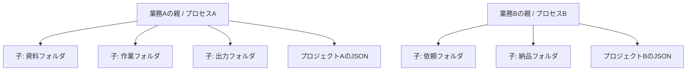

# 製品要件 v0.2

## 目的と用語

複数業務で使うフォルダを毎回開き直す手間を減らし、Windows Explorerに近い一覧・選択・キーボード操作で整理できるLinuxアプリを作ります。

| 用語 | 定義 |
|---|---|
| 業務ウィンドウ / 親 | OS上の独立したトップレベルウィンドウ。1プロセス・1プロジェクトを担当 |
| フォルダウィンドウ / 子 | 親のMDI領域にある1つのフォルダ表示。履歴・選択・表示設定を個別に保持 |
| プロジェクト | 子で開いているフォルダ群、順序、表示状態、配置のスナップショット |
| 復元記録 | 保存操作とは別に作る、異常終了からの復帰用の一時状態 |

## 必須範囲

| ID | 要件 |
|---|---|
| WIN-01 | 親を複数同時に起動する。親を閉じても別の親は閉じない |
| WIN-02 | 親の中に複数の子を開き、移動・サイズ変更・最大化・最小化・閉じるを行う |
| WIN-03 | 自由配置、縦整列、横整列、格子整列、重ねて表示、タブ表示を選べる |
| WIN-04 | Ctrl+Nは現在の親への子追加。Ctrl+Alt+Nは新しい親。最後の子を閉じても親は残る |
| NAV-01 | アドレス入力、パンくず、戻る・進む・上へ・更新を備える。履歴は子ごとに独立 |
| NAV-02 | 子にフォルダツリーと一覧。詳細表示とアイコン表示。ツリーは折りたたみ可能 |
| NAV-03 | 名前・種類・サイズ・更新日時で整列。初期値はフォルダ優先、名前昇順、隠しファイル非表示 |
| NAV-04 | ローカルディスク、接続済みの外付け媒体、OSにマウント済みの共有フォルダを扱う |
| SEL-01 | 単一・Ctrlによる追加・Shift範囲・全選択、矩形選択、キーボード選択を備える |
| FILE-01 | 作成・名前変更・コピー・移動・ごみ箱・明示した完全削除をジョブとして実行 |
| FILE-02 | 子間・親間・外部ファイラとのコピー／移動。競合・進捗・中断・部分成功を表示 |
| FILE-03 | 安全に取り消せる範囲のUndoを提供し、不可逆な操作を成功したように戻さない |
| PRJ-01 | プロジェクトの新規作成、保存、名前を付けて保存、開く、履歴から開く |
| PRJ-02 | 保存した子のフォルダ・配置・表示状態を復元。行方不明のフォルダも子として残す |
| PRJ-03 | 同じプロジェクトの競合保存、破損JSON、未知の形式、異常終了に対応 |
| PERF-01 | 一覧読み込みと操作の待ち時間で親全体の入力を止めない。目標は検証計画に定義 |
| PRIV-01 | 実データ・プロジェクト・履歴・ログはリポジトリ外に置く。通信や送信を勝手に行わない |

## 操作の具体化

初回起動は未保存の親とホームフォルダの内部ファイラ1つを開きます。Ctrl+Nの「内部ファイラを追加」は、常にホームディレクトリを開きます。アクティブな子の表示設定のみを引き継ぎ、場所・選択・戻る履歴は引き継ぎません。保存したプロジェクトやCLIで指定した場所は、その指定どおりに開きます。同じフォルダを複数の子で表示できます。

新しい子は重ねて開きます。整列は利用者の操作時に行い、自動で既存の手動配置を崩しません。縦整列は左右に並べる、横整列は上下に並べる、とメニューの補足で説明します。格子整列は子の順序を保ちます。タブ表示への切り替え前の自由配置を保持し、戻したときに復元します。初期の対応上限は親あたり64子、性能の基準は20子です。

プロジェクトAとBを同時に開くと別々の親になります。「開く」は既存の親を置き換えず、新しい親を起動します。同じファイルを開いた場合の保存制御は[保存形式](04-project-format.md)に従います。別プロジェクトが同じフォルダを指すことは許可し、ファイル内容を業務ごとに隔離する機能とはしません。

親の共通メニュー・主要操作はコンパクトにまとめ、操作の対象はアクティブな内部ファイラとします。各子は短いタイトル、戻る／進む／上へ・アドレスの1行、ツリーと一覧、コンパクトなステータスバーを持ちます。ステータスには表示件数・一覧の選択件数・選択ファイルのサイズを表示し、再帰的なフォルダ容量計算は行いません。操作中は進捗、完了後は結果を同じバーへ表示します。親にも進捗・中断ボタンがあり、操作元の子を閉じても追跡できます。大きい見出しやリボンは設けません。親はLinuxの標準ウィンドウ装飾を使います。

ファイル名は大文字小文字を区別するLinuxの実態に従います。表示は日本語、日時は利用者のロケール、サイズはKiB / MiB等の単位を明示します。長い名前は省略表示し、ツールチップとプロパティで全体を確認できます。日本語IME変換中は操作ショートカットを発火させません。

## 検索・プレビュー

初版の検索欄は現在のフォルダのファイル名検索です。部分一致・大文字小文字を区別しない照合を標準とし、サブフォルダや本文は検索しません。検索範囲を欄に表示し、Escapeで条件を解除します。ファイルの同一性や競合判定には検索時の照合規則を使いません。

Alt+Pのプレビューパネルは、サイズ上限付きのテキストと画像のみを初版対象とします。テキストは先頭1MiB、画像は入力20MiB・復号後32メガピクセルまでを上限とし、超過は説明して開きません。画像処理は別ワーカー、初期はサムネイルの全件生成を行いません。スクリプト、HTML、PDF、外部アプリを自動実行するプレビューは初版に含めません。

## 起動とLinuxデスクトップ連携

実装する実行ファイル名は `moooyooo-linux-explorer` とします。引数なしなら未保存の親とホームの子を開きます。位置引数に複数のディレクトリを渡すと、1つの新しい親にそれぞれを子として開きます。相対パスは起動元の作業ディレクトリを基準とし、`--` 以降はオプション解釈しません。

`--project FILE` はプロジェクトを新しい親で開き、フォルダの位置引数と併用した場合は使用方法を表示してエラーにします。`--help` / `--version` はGUIを起動せず終了します。不正な引数は終了コード2、プロジェクトの形式や読み込み失敗は1、正常な終了は0とします。保存されたフォルダの一部が見つからないことは親全体の起動失敗とはせず、該当する子に表示します。

配布時にdesktopエントリーとプロジェクト形式の関連付けを用意します。OSの既定ファイラやWin+E相当の起動キーを、インストール時に無断で変更しません。ファイルを開く操作はOSの既定アプリ連携を使います。

## エラーと終了

読み取り権限なし、削除済み、媒体取り外し、読み込み中、空フォルダは異なる表示にします。使えない場所の子をホームへ黙って置き換えません。再試行・別の場所に変更・子を閉じるを選べます。権限昇格やsudo起動で自動回避しません。

保存対象の状態が変わったら親のタイトルに未保存マークを表示します。終了時は保存／保存せず終了／戻るを選びます。ジョブ実行中は完了を待つ／中断して終了／戻るを選び、中断要求中と中断完了を区別します。プロジェクトを保存してもファイル操作の取り消しや完了にはなりません。

## 初版に含めない機能

SMB / SFTP等への直接ログイン、接続情報の保存、クラウド連携、全文検索・再帰検索、アーカイブ編集、内蔵ターミナル、Git操作、外部プラグイン、root操作、Windows / macOS版は後続候補です。これらに必要な依存や秘密情報を先回りして導入しません。

Linuxで非UTF-8の生の名前は完全な操作対象とせず、曖昧な名前のまま書き込みを行いません。検出できる形で識別して操作不可を表示することを受け入れ条件に含めます。ハードリンク再構成、ACL・拡張属性・所有者の完全複製はバックアップ機能として保証せず、初版の扱いを[ファイル操作](06-file-operations.md)で定義します。
