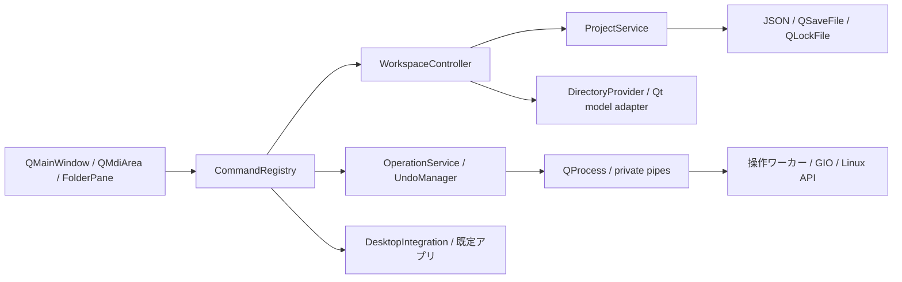

# 構成と拡張方針

## プロセス境界

親ウィンドウ1つをGUIプロセス1つとします。アプリの再起動や「新しい業務ウィンドウ」は既存プロセスに集約せず、新しいプロセスを起動します。コマンドラインの引数は配列として渡し、シェルで組み立てません。

各GUIプロセスは必要時だけファイル操作ワーカーを起動します。ワーカーはQt CoreとGIOを使う小さいネイティブ実行ファイルとし、GUI・テーマ・Webエンジンをロードしません。プレビューも別ワーカーに分離します。何も操作していない状態では補助プロセスを常駐させません。



## モジュールの責務

| モジュール | 主な型・責務 | 依存の制約 |
|---|---|---|
| domain | Project、PaneState、Location、OperationPlan、JobResult | Widgetsに依存しない |
| application | WorkspaceController、ProjectService、OperationService、UndoManager | UIのポインターを保存しない |
| ui | MainWindow、FolderPane、ProjectPicker、JobPanel、CommandRegistry | 操作要求をサービスへ渡す |
| filesystem | DirectoryProvider、モデルのadapter、変更通知 | 表示の読み取りのみ |
| platform/linux | GIO、既定アプリ、クリップボード形式、XDG保存先 | OS固有処理を集約 |
| persistence | ProjectRepository、RecoveryStore、設定 | バージョンとロックを管理 |
| workers | ファイル操作・限定プレビュー | 権限昇格せず、指定された要求だけを処理 |

初期のファイル一覧は読み取り専用のQFileSystemModelを、GUIスレッド上のモデルとして利用します。列挙用の内部スレッドと監視を利用し、子ごとの表示条件はproxy側に置きます。モデルは親内で共有し、子を増やすたびに同じツリーを複製しません。プロジェクトを長く使ったときのキャッシュ・監視数を測定し、保持上限を満たせない場合はDirectoryProviderの実装を置き換えます。

QFileSystemModelが非同期で列挙することは、全操作が必ず非ブロッキングになる保証ではありません。UIスレッドから再帰的なstat・容量計算・同期コピーを呼ばず、変更通知もまとめます。ネットワークマウントのI/O停止は別に評価します。[QFileSystemModel公式資料](https://doc.qt.io/qt-6.8/qfilesystemmodel.html)

## 操作とスレッド

QActionを子ごとに無制限に複製せず、親のCommandRegistryがフォーカスとアクティブな子から対象を決めます。入力中のコマンド解決は[キー仕様](05-shortcuts.md)を優先します。選択はモデルの行番号ではなく、Locationとファイルの識別情報で扱い、ソート・更新後に別ファイルへすり替わらないようにします。

一覧の読み取りモデルではファイル更新を無効にします。drop、F2、Delete等はすべてOperationPlanを作り、OperationServiceへ渡します。QFileSystemModelのremove / rmdir / setDataによる実更新は使いません。

ワーカーとの通信は継承した標準入出力パイプの長さ制限付きJSON Linesとします。job_id、protocol_version、request / progress / conflict / cancel / completedを定義し、stdoutにはプロトコルだけを出します。実パスはコマンドラインや通常ログへ書かず、必要なパイプ内で渡します。最大メッセージは1MiB、ファイル一覧は256件以下のバッチに分けます。受付上限を超えた要求は失敗として返し、命令文字列の評価は行いません。

更新ジョブは親あたり同時2件まで、同じ場所に影響するジョブは直列化します。プロセス外の別アプリによる変更もあり得るため、この直列化だけを排他の根拠にしません。最終確定時に競合・同一性を再確認します。進捗は最大10回/秒でGUIへ通知します。

GIOの単一ファイルコピーだけではフォルダの再帰コピーは完成しません。再帰列挙、競合方針、部分成功の記録はOperationServiceとワーカー側の計画に明示して実装します。[GIOのコピー仕様](https://docs.gtk.org/gio/method.File.copy.html)

## 拡張の境界

DirectoryProvider、OperationBackend、PreviewProviderを内部インターフェースとします。最初はLocalのみを登録し、未実装のネットワークURLやアーカイブをLocalとして解釈しません。サーバー接続を追加する際はLocationの形式と操作能力の表現を拡張します。

プラグインを導入するときは、互換性・配布・権限・失敗時の分離を別の設計で確定します。プロジェクトファイルに実行コマンドや読み込むライブラリを記述できる構成にはしません。

## 実装開始時のディレクトリ案

```text
src/domain/           状態・操作計画
src/application/      プロジェクト・コマンド・ジョブの調停
src/ui/               Qt Widgets
src/filesystem/       一覧・変更通知
src/platform/linux/   Linux連携
src/persistence/      保存と復元
src/workers/          操作・プレビューの実行ファイル
tests/unit/           状態と保存形式
tests/integration/    架空ツリーを使うファイル操作
tests/gui/            キー・MDI・フォーカス
```

これはM1以降の構成案です。空の実装や動かないビルド対象は初回コミットに作りません。
