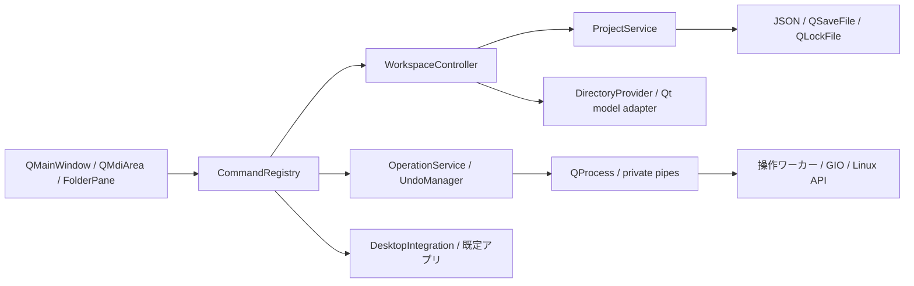

# 構成と拡張方針

## プロセス境界

親ウィンドウ1つをGUIプロセス1つとします。アプリの再起動や「新しい業務ウィンドウ」は既存プロセスに集約せず、新しいプロセスを起動します。コマンドラインの引数は配列として渡し、シェルで組み立てません。

各GUIプロセスは必要時だけファイル操作ワーカーを起動します。ワーカーはQt CoreとGIOを使う小さいネイティブ実行ファイルとし、GUI・テーマ・Webエンジンをロードしません。プレビューも別ワーカーに分離します。何も操作していない状態では補助プロセスを常駐させません。



## モジュールの責務

以下は製品全体の設計です。現在は `mlex_core`（domain / application / persistence / platform）、`mlex_ui`（MainWindow / FolderPane / CommandRegistry / FileCommands）、`mlex_operations`（操作エンジン）を実装しています。`OperationService` はQt Coreのみでジョブ・IPC・Undo履歴・記録を管理し、`mlex-file-worker` が実更新を行います。画面調停はMainWindow、キー・ダイアログ・クリップボードはFileCommandsへ分離しています。保存検証と操作ワーカーはWidgetsに依存しません。

| モジュール | 主な型・責務 | 依存の制約 |
|---|---|---|
| domain | Project、PaneState、Location、OperationPlan、JobResult | Widgetsに依存しない |
| application | WorkspaceController、ProjectService、OperationService、UndoManager | UIのポインターを保存しない |
| ui | MainWindow、FolderPane、ProjectPicker、JobPanel、CommandRegistry | 操作要求をサービスへ渡す |
| filesystem | DirectoryProvider、モデルのadapter、変更通知 | 表示の読み取りのみ |
| platform/linux | GIO、既定アプリ、クリップボード形式、XDG保存先 | OS固有処理を集約 |
| persistence | ProjectRepository、RecoveryStore、設定 | バージョンとロックを管理 |
| workers | ファイル操作・限定プレビュー | 権限昇格せず、指定された要求だけを処理 |

初期のファイル一覧は読み取り専用のQFileSystemModelを、GUIスレッド上のモデルとして利用します。列挙用の内部スレッドと監視を利用し、子ごとの表示条件はproxy側に置きます。モデルは親内で共有し、子を増やすたびに同じツリーを複製しません。プロジェクトを長く使ったときのキャッシュ・監視数を測定し、保持上限を満たせない場合はDirectoryProviderの実装を置き換えます。

QFileSystemModelが非同期で列挙することは、全操作が必ず非ブロッキングになる保証ではありません。UIスレッドから再帰的なstat・容量計算・同期コピーを呼ばず、変更通知もまとめます。ネットワークマウントのI/O停止は別に評価します。[QFileSystemModel公式資料](https://doc.qt.io/qt-6.8/qfilesystemmodel.html)

## 操作とスレッド

QActionを子ごとに無制限に複製せず、親のCommandRegistryがフォーカスとアクティブな子から対象を決めます。入力中のコマンド解決は[キー仕様](05-shortcuts.md)を優先します。選択はモデルの行番号ではなく、Locationとファイルの識別情報で扱い、ソート・更新後に別ファイルへすり替わらないようにします。

一覧の読み取りモデルではファイル更新を無効にします。drop、F2、Delete等はすべてOperationPlanを作り、OperationServiceへ渡します。QFileSystemModelのremove / rmdir / setDataによる実更新は使いません。

ワーカーとの通信は継承した標準入出力パイプの長さ制限付きJSON Linesです。job_id、protocol_version=1、request / progress / cancel / completedを実装し、stdoutにはプロトコルだけを出します。同名競合の方針は起動前のUIで選び、実行時の新たな競合は上書きせず失敗として返します。実パスはコマンドラインへ書かず、必要なパイプとアクセス制限した操作記録で扱います。最大メッセージは1MiB、操作元は256件・JSON 256KiB未満、要求全体は768KiB以下です。上限超過は分割して操作するよう説明します。命令文字列の評価は行いません。

現在の更新ジョブは親あたり1件ずつ直列実行します。将来拡張時も同時2件を上限とし、同じ場所に影響するジョブは直列化します。別の親・外部アプリとの排他にはならないため、確定時にも競合・同一性を再確認します。進捗は最大10回/秒でGUIへ通知します。ワーカーはイベントループで中断要求を受け、操作用スレッドへatomicフラグとGCancellableで通知します。親のパイプが閉じた場合も中断を要求します。

GIOの単一ファイルコピーだけではフォルダの再帰コピーは完成しません。再帰列挙、競合方針、部分成功の記録はOperationServiceとワーカー側の計画に明示して実装します。[GIOのコピー仕様](https://docs.gtk.org/gio/method.File.copy.html)

## 拡張の境界

DirectoryProvider、OperationBackend、PreviewProviderを内部インターフェースとします。最初はLocalのみを登録し、未実装のネットワークURLやアーカイブをLocalとして解釈しません。サーバー接続を追加する際はLocationの形式と操作能力の表現を拡張します。

プラグインを導入するときは、互換性・配布・権限・失敗時の分離を別の設計で確定します。プロジェクトファイルに実行コマンドや読み込むライブラリを記述できる構成にはしません。

## 拡張後のディレクトリ案

```text
src/domain/           状態・操作計画
src/application/      プロジェクト・コマンド・ジョブの調停
src/ui/               Qt Widgets
src/filesystem/       一覧・変更通知
src/platform/linux/   Linux連携
src/persistence/      保存と復元
src/workers/          操作・プレビューの実行ファイル
tests/unit/           状態と保存形式
tests/integration/    架空ツリーを使うファイル操作
tests/gui/            キー・MDI・フォーカス
```

これは拡張後の構成案です。現在は `src/domain/`、`src/application/`、`src/ui/`、`src/platform/`、`src/persistence/`、`src/workers/` と `tests/test_project.cpp`、`tests/test_workspace.cpp`、`tests/test_operations.cpp`、`tests/check_cli.py` を使用します。モデルは親で共有し、F5と更新操作後にモデルを再生成して全子へ接続し直します。履歴・検索・表示設定とパスによる選択を引き継ぎ、移動・名前変更されたフォルダを表示する子は新しい場所へ追従します。低速マウントでのモデル破棄・再生成の応答性は今後の評価対象です。
